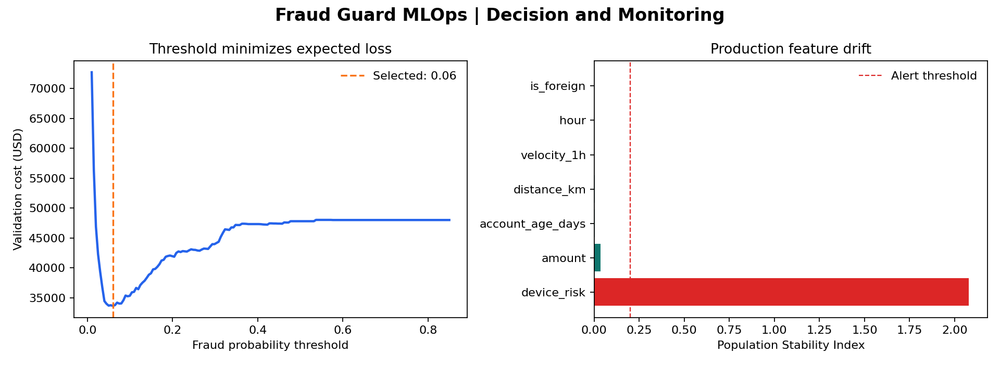

# Fraud Guard MLOps

> Cost-sensitive fraud detection with a decision threshold the business can defend and drift alerts the team can act on.


This project trains a fraud model on chronological transaction data, chooses a review threshold from explicit false-negative and investigation costs, then scores a shifted production window and calculates feature drift.



## Business result

The system produces a review queue, a serialized model bundle, and a drift report. The selected operating point minimizes expected validation loss instead of optimizing an arbitrary classification score.

| Production result | Value |
|---|---:|
| Average precision | 0.3170 |
| Fraud recall | 65.64% |
| Review rate | 16.04% |
| Selected threshold | 0.0597 |
| Drift alerts | 1 |

## What this demonstrates

- Imbalanced classification with precision-recall evaluation
- Cost-sensitive threshold optimization
- Chronological validation and production simulation
- Feature drift monitoring with Population Stability Index
- Reproducible artifacts, Docker, and CI

## Reproduce

```bash
python -m venv .venv
source .venv/bin/activate
make install
make run
```

The generated transaction stream includes a controlled production shift in amount and device risk. That makes the monitoring layer observable on every run and avoids publishing sensitive financial data.

## Repository map

```text
src/fraud_guard/         simulation, training, decisioning, monitoring
data/                    reproducible transaction snapshot
artifacts/               model, scores, metrics, drift report, chart
.github/workflows/       CI reproduction job
```

## Interview discussion

The next production steps would include probability calibration, delayed-label monitoring, case-management feedback, protected-group fairness checks, and a champion-challenger rollout.

